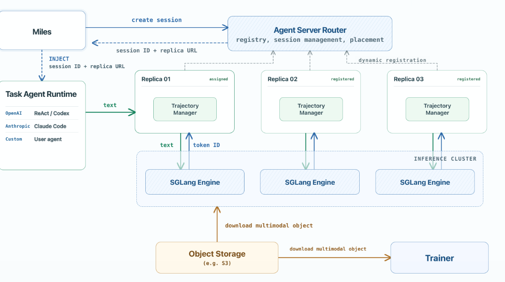
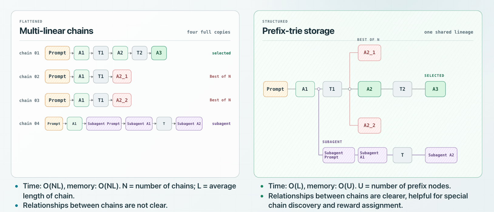
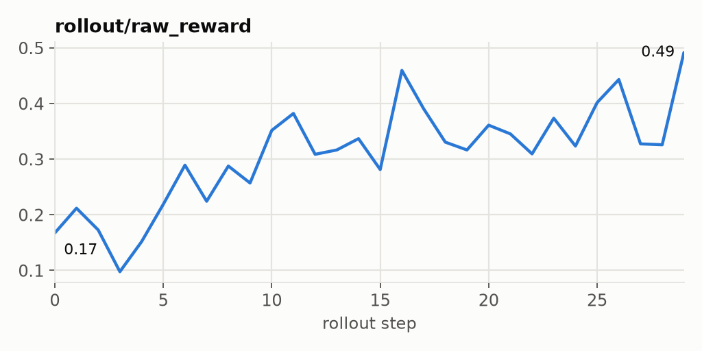
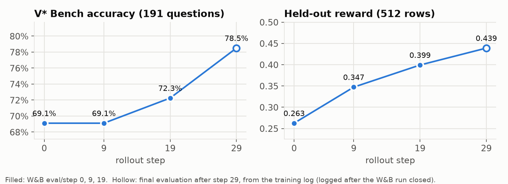
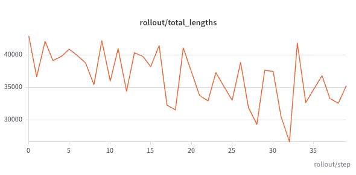
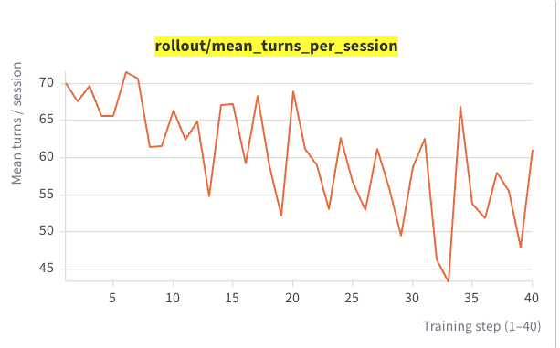
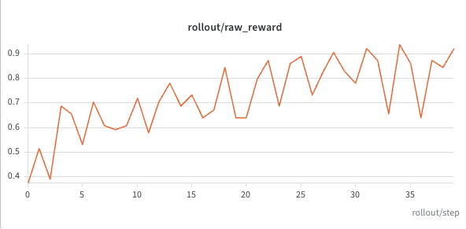

# Trajectory Representation and Tokenization for Multi-turn Agentic RL at scale

**TL;DR**

The project mainly consists of two components:
1. An http server (agent server) that does:
- Request Forwarding: intercept request from agent harness and forward it to SGLang engine for generation;
- Trajectory Representation: records every turn's trajectory in a *prefix-trie* data structure and conduct prefix matching for turn-merge, and exposes customize trajectory post processor API.
2. A tokenization component implemented on SGLang side that tokenize each turn's messages incrementally to ensure the assembly of multi-turn tokens are zero-drift. It also allows *multimodality* at *large scale*. 

**Catalog**

| Sections | What they cover |
| --- | --- |
| [1. Scope](#1-scope), [2. Overall Architecture and workflow](#2-overall-architecture-and-workflow) | What this middle layer covers, and how an episode flows through the Router, the replicas and SGLang |
| [3. Trajectory Manager](#3-trajectory-manager-on-agent-server-side), [4. Zero-Drift Multi-turn Tokenization](#4-zero-drift-multi-turn-tokenization-with-multimodality-at-scale) | The design decisions of the two components: trade-offs, engineering considerations, and comparisons with existing frameworks |
| [5. APIs and Files](#5-apis-and-files) | HTTP endpoints, and where each part of the code lives |
| [6. QuickStart and E2E Experiment Overview](#6-quickstart-and-e2e-experiment-overview) | How to turn the agent server on in Miles, how to reproduce and interpret the e2e examples |
| [7. Future Work](#7-future-work) | What is worth doing as an extension |

## 1. Scope
This is a middle layer that sits between the agent harness layer and the RL infrastructure. It only covers a pipeline that transform the agent harness behavior into training evidence. 
The below are not implemented in this take-home but is used directly.
1. agent harness layer is supported by third-party provider. (e.g. E2B sandbox for this take-home)
2. RL infrastructure is provided by miles, SGLang and Megatron/FSDP. 

## 2. Overall Architecture and workflow



The agent server is one Router plus N replicas. Each replica registers with the Router when it starts. An episode runs as follows:

1. Miles asks the Router to create a session.
2. The Router picks a replica, creates the session on it, and returns the session id and that replica's URL to Miles.
3. Miles injects the URL into the agent harness. From then on, the agent harness sends every request directly to that replica; the Router is no longer involved. 
4. The agent server replica calls SGLang for generation, SGLang conducts multimodal object download (if need) and tokenization.
5. agent server send back generation result to harness layer, and that loop continues.
6. When a task is done, the session is closed and miles pulls trajectory data from agent server.


## 3. Trajectory Manager (On Agent Server Side)

### 3.1 Granularity Design Choice: one sample per turn vs. best-effort turn merge

- **One sample per turn.** Each generation is a sample: full prompt (mask 0) plus output (mask 1). T turns give T samples that repeat the shared history, costing Σ L_t tokens (L_t = length of turn t).
- **Best-effort turn merge.** A turn that extends a stored turn continues its tokens, so a root-to-leaf path is one sample of L_T tokens. Requests that extend nothing (compaction, sub-agents) start new roots and retries start branches; each is still exported, so no trajectory is lost and the trainable tokens are the same.

Ablation: 64 Claude Code sessions on SWE-Gym (4 tasks × 16), Qwen3.5-4B, 8×H100, 64K context; one rollout batch trained both ways for one step (reproduce with §6.3).
(Please click the blue text to jump to wandb log)
| | [Per turn](https://forge.coreweave.com/wandb/xiaoleg-carnegie-mellon-university/take-home-deliverable-original-run/runs/proxy-per-turn-01) | [Turn merge](https://forge.coreweave.com/wandb/xiaoleg-carnegie-mellon-university/take-home-deliverable-original-run/runs/proxy-merge-01) |
| --- | ---: | ---: |
| Samples | 4,439 | 64 |
| Training tokens | 105.3 M | 2.71 M |
| Loss tokens | 698,954 | 698,954 |
| Training time | 5,164 s | 596 s (8.7×) |
| Rollout + training | 5,890 s | 1,322 s (4.5×) |

Per turn computes 38.8× as many tokens for the same loss tokens, so the agent server uses best-effort turn merge for better efficiency.

### 3.2 Representation Design Choice: multi-linear chains vs. prefix trie
According to 3.1, we have decided to use best-effort merge. Then the next question is, when a turn can't be merged (e.g. subagent, compaction, best-of-N), how do we represent the lineage and store the trajectories? A natural way is to split it into another trajectory when it can't be merged. There are two ways of splitting and storing the trajectories.


- **Multi-linear chains** (e.g. verl uni-agent) copy the shared prefix into every chain: O(NL) time and memory, and how chains relate is lost.
- **Prefix trie** stores each turn once under the turn it extends: O(L) lookup, O(U) memory. Retries, best-of-N siblings and sub-agents stay visible, so Miles' picker and postprocessor hooks (`--session-sample-picker-path`, `--session-sample-postprocessor-path`) can pick trajectories and assign rewards per branch.

Since perfix trie representation is more efficient and it allows for customized trajectory picking and reward assignment, agent server adopts this method.

### 3.3 Delta nodes and efficient CPU memory

```text
tokens(node) = tokens(parent)[:prefix_len] + input_delta + output_tokens
```

A node stores only its delta information, so each token, logprob, message, R3 and image reference is stored once which saves CPU memory; full sequences are rebuilt only for in-flight prompts and export. 


### 3.4 Data structures and interface

```python
prepare(messages, *, context_key) -> PreparedTurn        # find the parent, return its tokens
commit(prepared, generation) -> TurnNode                 # store SGLang's prompt edit and output
tokens(node_id) -> list[int]                             # rebuild a full sequence from deltas
leaf_samples(*, max_seq_len, tokenizer) -> list[Sample]  # one sample per root-to-leaf path
tree_metadata() -> dict                                  # node/leaf tables for picker/postprocessor
clear() -> None
```

A request runs `prepare` → SGLang → `commit`. Both are synchronous on one event loop, so no lock is needed. The parent is fixed in `prepare`, so concurrent requests from one turn become siblings.

- **Finding the parent.** Messages are fingerprinted and walked through a trie keyed by tools and template kwargs; the deepest position where a committed turn ends is the parent (latest commit on ties). The last message is never consumed, so an identical request becomes a retry sibling.
- **Reconstructing the trajectory.** Before the request goes to SGLang, `tokens(parent)` is rebuilt by walking from the root to the parent and applying each node's delta. It is sent as `input_ids` with `prefix_message_count`, so SGLang renders only the new messages (§4). 
- **Committing the new node.** `commit` stores the turn as the parent's child: `prefix_len = len(tokens(parent)) - removed_prefix_token_count`, SGLang's `input_delta`, output tokens and logprobs, the new messages plus the reply, R3 rows and image references. The turn is then indexed in the trie under its messages' fingerprints.

### 3.5 Why trajectories live on the agent server, not in SGLang

SGLang stays stateless so that engine failures are cheap to handle. Every request carries everything an engine needs (`input_ids`, `messages`, `prefix_message_count`), and a turn is committed only after its reply arrives.

If an engine dies mid-generation, only the turn it was generating is lost; every committed turn stays on the agent server. Nothing was committed for that turn, so the replica sends the same request to the router again, which assigns an engine and skips those its health checks have marked dead. The retry continues from the same parent and only recomputes the prefix cache.

So the trajectory manager runs on the agent server in the CPU cluster, and the SGLang engines in the GPU cluster can be replaced at any time.

## 4. Zero-Drift Multi-turn Tokenization with Multimodality at Scale

Note: for the Continuous Token component, this take home is based on the codes implemented on verl (the work of mine during my internship at Bytedance). The modification and novelty in this take home is 
1) it's refactored to be implemented on SGLang side;
2) It adds the support for multimodality.

### 4.1 Principles

1. **Token in, token out (TITO).** SGLang consumes token ids and returns token ids, the agent server stores them, and the trainer gets exactly the ids that were sampled. Text is never re-tokenized: decode → encode is not a round trip (BPE may split the same text differently), so re-tokenizing would create a training–inference mismatch.
2. **Append-only encoding.** The agent harness sends plain-text messages, and turn merge (§3.1) builds each prompt as the parent's tokens plus the new messages. Only the new messages are encoded; the parent's tokens are reused as they are and never decoded. The SGLang patch therefore takes `prefix_message_count` next to `input_ids`, so SGLang knows which messages are new.
3. **Model-specific boundary adapters.** Appending turn by turn must give the same tokens as one `apply_chat_template` over the whole conversation. Where a stopped generation and the template disagree at the junction, a per-model adapter fixes it: Qwen inserts the `\n` its template puts after `<|im_end|>`, and GLM, whose stop tokens `<|user|>`/`<|observation|>` also open the next message, keeps one of them at the junction (replacing the generated one, reported as `removed_prefix_token_count`, only when the next message opens with the other). `test_continuous_token.py` checks the turn-by-turn result against full renders.

### 4.2 Design Choice: Why tokenization runs inside SGLang

Open-source frameworks such as Miles and Verl tokenize multi-turn conversations outside the inference engine, in the single controller or in a proxy like this agent server. This design moves it into SGLang so that multimodality can scale.

- **Who fetches images.** Multimodal RL has to fetch large objects. A controller or agent server runs with low concurrency and would become the bandwidth bottleneck. SGLang engines are many, and they are the final consumers of the pixels, so letting them fetch spreads the downloads and avoids moving large objects between processes.
- **Who tokenizes text.** Expanding an image placeholder into its run of image tokens depends on the image itself. A tokenizer without the image cannot expand it, and keeping one placeholder for SGLang to expand by hand is error-prone and needs work for every new model. So text is tokenized in SGLang too: once the images are fetched, the model's own processor encodes text and images in one call.
- **Who trains.** The trainer consumes SGLang's token ids and fetches the images again itself. The same processor configuration gives the same result, so no image travels between processes.

Tokenizing in SGLang lets multimodality scale and keeps TITO, so tokens stay zero-drift.

### 4.3 Implementation Overview

Continuous token (CT) runs in SGLang's TokenizerManager, patched by [sglang_patch/](sglang_patch/). A request carries the parent's tokens as `input_ids` (empty for a new root), the full `messages` and `prefix_message_count`. SGLang renders `messages[prefix_message_count:]` onto the tokens, generates, and returns `meta_info.prompt_edit`: `removed_prefix_token_count`, `input_delta` and `routed_experts_start_len`.

- **Abstraction Design.** A base `ContinuousTokenBuilder` plus one subclass per model family, registered by `model_type` in `_BUILDERS_BY_MODEL_TYPE`; unregistered models use the base. Only Qwen and GLM are implemented for this take-home.
- **Caller API.** SGLang's `continue_prompt` picks the builder and calls one of two methods:
  - `build_initial_tokens(messages, tools)` for a new root renders the whole request;
  - `merge_context_tokens(messages[:k], messages, input_ids, tools)` continues a turn: it renders each appended group inside a synthetic context, appends the diff and returns a `MergeResult` (`token_ids`, `removed_prefix_token_count`). Assistant turns are never re-rendered, and tokens before the kept prefix are never decoded.
- **Subclass hooks**, for whoever adds a model family:
  - `_tokenize_tool_group`, `_tokenize_single_non_tool`: render one appended group;
  - `_merge_context_token_ids`: fix the junction with the parent's tokens. Qwen and GLM override only this one (Qwen inserts `\n`, GLM keeps one boundary token).
- **Images.** A group with images is encoded by the HF processor together with its images, which expands their placeholders. The synthetic context never holds images.


## 5. APIs and Files

**APIs**

| Process | Endpoint | Purpose |
| --- | --- | --- |
| Agent Server Router (Router) | `POST /replicas` | register a replica (`url` for Miles, `agent_url` for agents) |
| Router | `GET /replicas` | registered replicas; Miles starts rollout once all N are there |
| Router | `POST /sessions` | pick a replica at random, create the session there, return the handle |
| Agent Server Replica (replica) | `POST /sessions` | create a session and its `TrajectoryManager` |
| Replica | `POST /sessions/{id}/v1/chat/completions` | find the parent → SGLang renders (CT) and generates → commit the turn |
| Replica | `POST /sessions/{id}/v1/messages` | Anthropic messages, converted to the chat path above |
| Replica | `POST /sessions/{id}/samples` | export samples; carries the agent's reward and metadata |
| Replica | `DELETE /sessions/{id}` | drop everything the session holds |
| Replica | `/sessions/{id}/{path}` | anything else (e.g. Anthropic `count_tokens`) is forwarded to the backend unrecorded |

**Files**

| Path | Content |
| --- | --- |
| `agent_server/router.py` | replica registration, session placement |
| `agent_server/server.py` | replica HTTP app, session lifecycle, prepare → generate → commit |
| `agent_server/trajectory.py` | message trie, delta nodes, image references, sample assembly |
| `agent_server/protocol.py` | `SessionHandle`, `PreparedTurn`, `Generation`, `TurnNode`, `R3Chunk`, `AgentServerError` |
| `agent_server/backend.py` | request building, reply parsing (tokens, logprobs, versions, R3, prompt edit) |
| `agent_server/anthropic.py` | `/v1/messages` |
| `agent_server/miles_adapter.py` | worker specs, readiness, the Miles generate function and the agent server's flags |
| Miles hooks (outside this directory) | `miles/ray/specs/entrypoint.py` adds the Router and replica worker specs; `miles/ray/specs/rollout.py` hands the Router's provider to the rollout executor, and `miles/ray/rollout/rollout_executor.py` waits for every replica to register and sets `args.agent_server_router_url` |
| `agent_server/sglang_patch/` | what SGLang runs for the agent server: `agent_server/sglang_patch/continuous_token/` (CT builders, templates, image encoding; copied into SGLang) and `agent_server/sglang_patch/sglang.patch` (request fields and hooks), applied with `agent_server/sglang_patch/apply.sh`; `agent_server/sglang_patch/router.patch` and `agent_server/sglang_patch/build_router.sh` build the Rust router that forwards `prefix_message_count` |
| Trainer side (outside this directory) | samples carry image references, and each trainer rank loads and processes its own images: `miles/ray/rollout/train_data_conversion.py`, `miles/backends/training_utils/data/rollout.py`, `miles/backends/training_utils/data/multimodal.py`, `miles/utils/processing_utils.py`; `miles/rollout/session/samples/codec.py` carries `multimodal_inputs` |
| `agent_server/tests/` | `agent_server/tests/test_trajectory.py` (trie, deltas, export, R3, hooks; toy tokenizer); `agent_server/tests/test_backend.py` (backend retries); `agent_server/tests/test_continuous_token*.py` (CT against full renders); `agent_server/tests/test_replica.py` (Router plus two replicas plus a fake SGLang running CT); `agent_server/tests/test_multimodal.py` (turn-by-turn prompts, with and without images, against the one-shot HF processor; SGLang emulated with the same CT code, or a real patched SGLang); `agent_server/tests/test_swegym_*.py` (the SWE-Gym recipe and Claude Code round trips) |
| `agent_server/examples/` | `agent_server/examples/deepeyes_v1/` and `agent_server/examples/swegym/`: harness, launcher and data preparation for §6.2 and §6.3 |

## 6. QuickStart and E2E Experiment Overview

### 6.1 Using the agent server in a Miles run

SGLang must carry the patch (`sh agent_server/sglang_patch/apply.sh <sglang repo>`), and the router in front of it must forward `prefix_message_count`: `sh agent_server/sglang_patch/build_router.sh` builds Miles' default Rust router with that field (`--use-miles-router` also works). The examples below run on Modal (CLI ≥ 1.6). Each `modal_app.py` builds that image from `radixark/miles:dev-202610102218`.

A launcher turns the agent server on with:

```bash
--use-agent-server --agent-server-workers 2 \
--custom-generate-function-path agent_server.miles_adapter.generate \
--custom-agent-function-path my_agent.run --custom-agent-function-mode inline \
```

Note: 
- **Agent outside the cluster** (e.g. agent running in a remote sandbox, e.g. the claude code swe example running in E2B sandbox). Fix the ports with `--agent-server-port` and set `AGENT_SERVER_PUBLIC_URLS='{"<port>": "<public URL>"}'`; the Router hands that URL to the agent.

### 6.2 DeepEyes: multimodal tool use (as a validation for the multi-turn multimodality implementation)

The policy answers a question about an image and may call `image_zoom_in_tool` for a crop. Every crop is a new image in the conversation. [deepeyes_v1](examples/deepeyes_v1/) runs the DeepEyes v1 recipe: Qwen2.5-VL-7B-Instruct on one 8-GPU node (4 GPUs train, 3 serve rollouts, 1 serves the LLM judge), with 4,000 V* + ThinkLite training rows and 512 held out.

```bash
export MODAL_PROFILE=<workspace>
APP=agent_server/examples/deepeyes_v1/modal_app.py
modal run $APP::prepare   # policy and judge checkpoints, the train/val split and V* Bench (CPU)
modal run $APP::check     # real episodes turn by turn vs. the one-shot HF processor, and the tests (CPU)
modal run $APP::smoke     # 3 steps, with an evaluation and a checkpoint save
modal run --detach $APP::train --launcher-args "--num-rollout 30"
```

Results of a 30-step run ([W&B](https://forge.coreweave.com/wandb/xiaoleg-carnegie-mellon-university/take-home-deliverable-original-run/runs/lo9db6gi)):

| Chart | What it shows |
| --- | --- |
|  | **Rollout reward.** The recipe's reward (−0.2 to 2.0) on the training rollouts: 0.17 at the first step, 0.49 at the last. |
|  | **Evaluation**, before training and every 10 steps. V* Bench accuracy goes from 69.1% to 78.5%, the held-out reward from 0.263 to 0.439. |

A healthy run has `train_rollout_kl` around 0.001–0.002 and no image-token or grid mismatch on the trainer.

### 6.3 Claude Code on SWE-Gym: E2B sandboxes

Claude Code solves SWE-Gym tasks in E2B sandboxes and talks Anthropic `/v1/messages` to the agent server; a fresh sandbox grades the candidate patch with the task's tests. Qwen3.5-4B on one 8-GPU node: 4 GPUs train (TP 2, CP 2), 4 serve rollouts, 64K context, up to 80 turns. Code and launcher are in [examples/swegym](examples/swegym/).

```bash
cd agent_server/examples/swegym
export E2B_API_KEY_FILE=<key file> SWEGYM_GATEWAY_TOKEN_FILE=/tmp/swegym-gateway-token SWEGYM_AGENT_SERVER_WORKERS=4
python prepare.py --input train.parquet --harness-root SWE-Bench-Package --output $DATA   # train.jsonl, tasks.json
python templates.py --data-dir $DATA --calibrate   # E2B templates; empty patch must fail, gold patch must pass
python gateway.py &   # token-checked, Anthropic-only entry on :30080; expose it to E2B over an HTTPS tunnel
cd ../../..
python agent_server/examples/swegym/run_qwen3_5_4b_swegym.py --model-dir $MODELS --data-dir $DATA --output-dir $OUT \
    --public-url https://<tunnel> --e2b-api-key-file <key file> --num-rollout 40
```

The per-turn vs. turn-merge ablation of §3.1 is the same launcher for one step, once per way: `--num-rollout 1 --no-fully-async --no-save-optimizer --extra-args '--rollout-function-path paired_ablation.Baseline'` (then `paired_ablation.MergedReplay`), each with `--custom-rollout-log-function-path paired_ablation.log_rollout`. The baseline collects one batch and freezes it under `/workspace/proxy-turn-ablation/paired-data`; the merged way trains on the same frozen trajectories.

**40-step end-to-end run** ([W&B](https://forge.coreweave.com/wandb/xiaoleg-carnegie-mellon-university/take-home-deliverable-original-run/runs/merged-proxy-40-02)). To check the whole stack end to end, I trained the setup above for 40 steps: 64 episodes per step, fully async with weights at most one version stale. All 40 updates were valid, in 7.5 hours. The run used an earlier revision of this agent server, before tokenization moved into SGLang (§4).

| Chart | What it shows |
| --- | --- |
|  | **Context length.** Mean tokens per episode, against the 64K cap: 27K–43K per step, 36.6K on average; the longest episode had 48K. |
|  | **Turns.** Mean turns per session: about 70 at the start and mostly 45–65 later. Each episode is a long-horizon task. |
|  | **Rollout reward.** It rises from 0.57 (mean of the first 10 steps) to 0.83 (last 10). Building each task's E2B template was slow, so to fit the time budget the run trained only on a small subset of tasks. The rise is on these training tasks only and does not necessarily indicate better generalization. |

**This run shows that the stack implemented in this take-home can trains long-horizon multi-turn task end to end, with a training effect and no visible bug. It does not show a tuned recipe or strong final performance.**

## 7. Future Work

- **Image cache in SGLang.** Every turn loads and processes all of the prompt's earlier images again. A cache keyed by a reference the agent server supplies (a URL or content hash) would skip both, leaving one processor call per turn.
- **Trajectory persistence.** Trajectories live only in replica memory: a replica that crashes loses its sessions, and long agent episodes keep large trees in RAM. Committed turns are append-only deltas (§3.3), so they can be written to disk or object storage as they arrive. A restarted replica could then recover its sessions, finished sessions could leave memory, and trajectories could be replayed offline for debugging or reuse.
- **More model families in CT.** Only Qwen and GLM have builders. Each new family (DeepSeek V3, Kimi K2, gpt-oss's harmony format, Llama, MiniMax, ...) needs its junction rule and a turn-by-turn vs. full-render test. 
